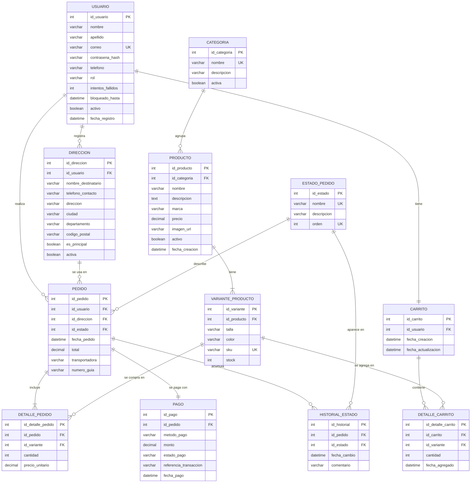

# Página web para una tienda de ropa

Proyecto de **Desarrollo de Software II** · Tecnología en Desarrollo de Software
Universidad del Valle, Regional Zarzal · Docente: Gustavo Osorio
Fecha: 20 de octubre de 2026

**Lenguajes:** Java · HTML · CSS

---

## 1. Integrantes del proyecto

| Nombre | Código |
| --- | --- |
| Katherine Arboleda Ocoro | 2478504 |
| Divis Smith Ramírez Barrientos | 2461046 |
| Joseph Alejandro Segura | 2460842 |
| Ralay Montaño Hurtado | 2460997 |
| Luisa María Noreña | 2460789 |

---

## 2. Idea de desarrollo web elegida

Una página web para una **tienda de ropa** que permite a los clientes consultar los productos, realizar compras y hacer seguimiento de sus pedidos. Los administradores gestionan el catálogo, el inventario y el estado de los pedidos desde un panel restringido.

Flujo principal: *registrarse → explorar y filtrar el catálogo → agregar al carrito → crear el pedido → consultar su estado.*

---

## 3. Requerimientos funcionales (Historias de usuario – Épicas)

| Código | Requisito funcional |
| --- | --- |
| RF1 | El sistema debe permitir registrar usuarios. |
| RF2 | El sistema debe permitir iniciar sesión. |
| RF3 | El sistema debe permitir mostrar los productos disponibles y consultar sus detalles. |
| RF4 | El sistema debe permitir buscar y filtrar productos. |
| RF5 | El sistema debe permitir agregar al carrito. |
| RF6 | El sistema debe permitir realizar pedidos. |
| RF7 | El sistema debe permitir consultar el estado del pedido. |

### Épica 1. Registro e inicio de sesión

| ID | Historia de usuario | Criterios de aceptación | Prioridad | Req. |
| --- | --- | --- | --- | --- |
| HU-01 | Como visitante, quiero registrarme con mis datos personales, para poder comprar y seguir mis pedidos. | • El formulario pide nombre, apellido, correo, teléfono y contraseña. • Si el correo ya está registrado, se muestra un mensaje claro y no se crea la cuenta. • La contraseña tiene mínimo 8 caracteres y se guarda cifrada, no en texto plano. • Los campos vacíos o con formato inválido se señalan antes de enviar. • Al registrarse con éxito se crea la cuenta con rol cliente y se confirma al usuario. | Alta | RF1 |
| HU-02 | Como cliente registrado, quiero iniciar sesión con mi correo y contraseña, para acceder a mi cuenta, mi carrito y mis pedidos. | • Con credenciales válidas accedo a mi cuenta. • Con credenciales incorrectas veo un mensaje genérico que no revela cuál dato falló. • Tras 5 intentos fallidos seguidos la cuenta se bloquea temporalmente. • Las páginas de cuenta, carrito y pedidos solo se abren con sesión activa. | Alta | RF2 |
| HU-03 | Como cliente, quiero cerrar sesión, para proteger mi cuenta en dispositivos compartidos. | • El botón «Cerrar sesión» es visible en toda la página. • Al cerrar, la sesión se invalida y el botón «atrás» del navegador no devuelve a páginas privadas. | Media | RF2 compl. |
| HU-04 | Como cliente, quiero restablecer mi contraseña por correo, para recuperar el acceso si la olvido. | • Se envía un enlace al correo registrado. • El enlace caduca en 1 hora y solo sirve una vez. • La nueva contraseña cumple las mismas reglas que en HU-01. | Media | RF2 compl. |
| HU-05 | Como cliente, quiero editar mis datos y guardar direcciones de envío, para agilizar mis compras. | • Puedo editar nombre, apellido y teléfono. • Puedo agregar varias direcciones y marcar una como principal. • Una dirección que ya se usó en un pedido no se edita ni se borra: se crea una nueva y la anterior se desactiva. • El correo no se puede cambiar. | Media | RF1 compl. |

### Épica 2. Catálogo, búsqueda y filtros

| ID | Historia de usuario | Criterios de aceptación | Prioridad | Req. |
| --- | --- | --- | --- | --- |
| HU-06 | Como visitante o cliente, quiero ver el catálogo de productos disponibles, para conocer qué ropa ofrece la tienda. | • Cada producto muestra imagen, nombre y precio. • Solo aparecen productos activos con stock en al menos una variante. • El catálogo está paginado. • Se puede ver sin iniciar sesión. | Alta | RF3 |
| HU-07 | Como visitante o cliente, quiero ver el detalle de un producto con sus tallas y colores, para elegir la variante correcta. | • Se muestran descripción, marca, categoría, precio e imagen. • Se listan las tallas y colores disponibles. • Las combinaciones sin stock aparecen deshabilitadas. • Si no hay stock en ninguna variante, el producto indica «Agotado». | Alta | RF3 |
| HU-08 | Como visitante o cliente, quiero buscar productos por nombre o palabra clave, para encontrar rápido lo que necesito. | • La búsqueda revisa nombre y descripción. • No distingue mayúsculas ni tildes. • Si no hay resultados, se muestra un mensaje y un enlace al catálogo completo. • Los resultados respetan los filtros activos. | Alta | RF4 |
| HU-09 | Como visitante o cliente, quiero filtrar y ordenar los productos, para reducir el catálogo a lo que me interesa. | • Puedo filtrar por categoría, talla, color y rango de precio. • Los filtros se pueden combinar. • Se muestra la cantidad de resultados. • Hay un botón para limpiar todos los filtros. • Puedo ordenar por precio de menor a mayor, de mayor a menor y por más recientes. | Alta | RF4 |

### Épica 3. Carrito de compras

| ID | Historia de usuario | Criterios de aceptación | Prioridad | Req. |
| --- | --- | --- | --- | --- |
| HU-10 | Como cliente, quiero agregar un producto al carrito con su talla y color, para reunir lo que voy a comprar. | • Debo elegir talla y color antes de agregar. • La cantidad no puede superar el stock de esa variante. • Si la variante ya está en el carrito, se suma la cantidad. • Se muestra una confirmación y el contador del carrito se actualiza. • Si no he iniciado sesión, se me pide hacerlo y luego vuelvo al producto. | Alta | RF5 |
| HU-11 | Como cliente, quiero ver mi carrito, cambiar cantidades y quitar productos, para ajustar mi compra antes de pedir. | • Cada línea muestra imagen, nombre, talla, color, precio unitario, cantidad y subtotal. • El total se recalcula al cambiar una cantidad o quitar una línea. • La cantidad mínima es 1 y la máxima es el stock. • Quitar un producto pide confirmación. • Si el carrito está vacío, se muestra un mensaje y un enlace al catálogo. | Alta | RF5 |
| HU-12 | Como cliente, quiero que mi carrito se conserve al cerrar sesión, para continuar mi compra después. | • El carrito se guarda en mi cuenta. • Al volver a iniciar sesión aparece con los mismos productos. • Si cambió un precio o se agotó una variante, se me avisa. | Media | RF5 compl. |

### Épica 4. Pedidos

| ID | Historia de usuario | Criterios de aceptación | Prioridad | Req. |
| --- | --- | --- | --- | --- |
| HU-13 | Como cliente, quiero convertir mi carrito en un pedido eligiendo la dirección de envío y el método de pago, para completar mi compra. | • Solo se puede pedir con sesión iniciada y carrito no vacío. • Elijo una dirección guardada o registro una nueva. • Elijo un método de pago. • Antes de confirmar veo el resumen con productos, cantidades y total. • Al confirmar se valida el stock; si falta alguno, se me avisa y el pedido no se crea. • Si todo está bien, se crea el pedido con estado «Pendiente», se descuenta el stock y se vacía el carrito. • Los precios quedan guardados tal como se cobraron. | Alta | RF6 |
| HU-14 | Como cliente, quiero recibir la confirmación de mi pedido, para tener un comprobante. | • Al terminar veo una pantalla con el número de pedido, el detalle y el total. • Recibo el mismo resumen por correo. | Media | RF6 compl. |
| HU-15 | Como cliente, quiero cancelar un pedido que aún no se ha preparado, para corregir un error. | • Solo puedo cancelar pedidos en estado «Pendiente» o «Confirmado». • Al cancelar, el estado pasa a «Cancelado» y el stock se devuelve. • El pedido cancelado sigue visible en mi historial. | Media | RF6 compl. |

### Épica 5. Seguimiento del pedido

| ID | Historia de usuario | Criterios de aceptación | Prioridad | Req. |
| --- | --- | --- | --- | --- |
| HU-16 | Como cliente, quiero ver la lista de mis pedidos, para consultarlos cuando quiera. | • La lista muestra número de pedido, fecha, total y estado. • Solo aparecen mis pedidos. • Se ordenan del más reciente al más antiguo. • Puedo filtrarlos por estado. | Alta | RF7 |
| HU-17 | Como cliente, quiero consultar el estado y el detalle de un pedido, para saber en qué etapa va. | • Veo el estado actual del pedido. • Veo el historial de cambios de estado con fecha y hora. • Veo los productos, cantidades, precios, dirección de envío y método de pago. • Si el pedido está enviado y hay datos, veo la transportadora y el número de guía. • No puedo abrir pedidos de otros clientes. | Alta | RF7 |

### Épica 6. Administración de la tienda

| ID | Historia de usuario | Criterios de aceptación | Prioridad | Req. |
| --- | --- | --- | --- | --- |
| HU-18 | Como administrador, quiero crear, editar y desactivar productos con sus variantes, para mantener el catálogo al día. | • Un producto lleva nombre, descripción, marca, precio, categoría e imagen. • Cada variante lleva talla, color, SKU único y stock. • El precio es mayor que 0 y el stock no es negativo. • Desactivar un producto lo oculta del catálogo sin borrar los pedidos que ya lo incluyen. | Alta | RF3 compl. |
| HU-19 | Como administrador, quiero gestionar las categorías, para organizar los productos. | • Puedo crear, editar y desactivar categorías. • El nombre de la categoría no se repite. • No puedo desactivar una categoría que tenga productos activos. | Media | RF3 compl. |
| HU-20 | Como administrador, quiero actualizar el stock de cada variante, para que el catálogo refleje las existencias reales. | • Puedo cambiar el stock de una variante. • El stock nunca queda negativo. • Una variante con stock 0 se muestra como agotada en el catálogo. | Media | RF3 compl. |
| HU-21 | Como administrador, quiero ver todos los pedidos y cambiar su estado, para que los clientes puedan hacer seguimiento. | • La lista de pedidos se puede filtrar por estado y fecha. • Los estados avanzan en orden: Pendiente, Confirmado, En preparación, Enviado, Entregado. • Puedo cancelar un pedido en cualquier estado anterior a «Enviado». • Cada cambio queda registrado con fecha y hora en el historial del pedido. • Al pasar a «Enviado» puedo registrar transportadora y número de guía. • Si cancelo, el stock se devuelve. | Alta | RF7 compl. |
| HU-22 | Como administrador, quiero un panel de administración con acceso restringido, para que ningún cliente pueda modificar la tienda. | • Solo el rol administrador entra al panel. • Un cliente o visitante que intente entrar recibe un mensaje de acceso denegado. | Alta | RNF Seguridad compl. |

---

## 4. Requerimientos no funcionales (Definition of Done)

Una historia de usuario se considera **terminada** solo si, además de cumplir sus criterios de aceptación, cumple con lo siguiente:

### Seguridad (HU-23)
- [ ] Todo el sitio funciona sobre HTTPS.
- [ ] Las contraseñas se guardan con hash y salt (por ejemplo, bcrypt).
- [ ] Las consultas a la base de datos son parametrizadas para evitar inyección SQL.
- [ ] Cada cliente solo accede a sus propios datos, direcciones y pedidos.
- [ ] La sesión expira tras 30 minutos de inactividad.
- [ ] No se guardan en la base de datos los números completos de tarjeta.

### Usabilidad (HU-24)
- [ ] El menú principal muestra siempre catálogo, buscador, carrito y cuenta.
- [ ] Desde el carrito, el pedido se completa en 4 pantallas como máximo: carrito, dirección, pago y confirmación.
- [ ] Los errores se explican en español, junto al campo afectado.
- [ ] Los botones y etiquetas usan los mismos nombres en todo el sitio.
- [ ] Las imágenes llevan texto alternativo y el contraste de colores es legible.

### Rendimiento (HU-25)
- [ ] El catálogo carga en 3 segundos o menos con una conexión de internet estándar.
- [ ] Las imágenes están optimizadas y se cargan de forma diferida.
- [ ] El catálogo se pagina para no cargar todos los productos a la vez.
- [ ] Las búsquedas y filtros responden en 2 segundos o menos.

### Compatibilidad (HU-26)
- [ ] El diseño se adapta a pantallas de celular, tablet y escritorio.
- [ ] Funciona en las dos últimas versiones de Chrome, Firefox, Edge y Safari.
- [ ] No hay desplazamiento horizontal en celular.
- [ ] Los botones son lo bastante grandes para tocarse con el dedo.

### Disponibilidad (HU-27)
- [ ] La disponibilidad objetivo es 99 % mensual.
- [ ] Los mantenimientos se programan en horas de baja demanda y se avisan con anticipación.
- [ ] Se hace una copia de seguridad diaria de la base de datos.
- [ ] Si el servicio falla, se muestra un mensaje amable en lugar de un error técnico.

### Criterios generales de calidad
- [ ] El código está en una rama propia y se integra a `main` mediante Pull Request revisado por otro integrante.
- [ ] El código compila y se ejecuta sin errores.
- [ ] La funcionalidad fue probada manualmente por quien la desarrolló y por un revisor.

---

## 5. Requerimientos técnicos (Historias técnicas)

| ID | Historia técnica | Criterios de aceptación |
| --- | --- | --- |
| HT-01 | Como equipo de desarrollo, queremos un repositorio en GitHub con una estructura de carpetas definida, para trabajar de forma ordenada. | • Existe `README.md`, `.gitignore` para Java y la carpeta `docs/`. • Todos los integrantes tienen acceso como colaboradores. • Se trabaja con ramas por historia (`feature/hu-xx-nombre`) y Pull Requests. |
| HT-02 | Como equipo de desarrollo, queremos un proyecto Java configurado con su herramienta de build, para compilar y ejecutar la aplicación. | • El proyecto compila y arranca con un solo comando. • Las dependencias están declaradas en el archivo de build. • Cualquier integrante puede ejecutarlo siguiendo el README. |
| HT-03 | Como equipo de desarrollo, queremos un script SQL que cree la base de datos, para que todos tengan el mismo esquema. | • El script crea las 11 tablas con sus llaves primarias, foráneas, únicas y restricciones. • Carga los 6 estados iniciales de `ESTADO_PEDIDO`. • Incluye datos de prueba (categorías, productos, variantes y un administrador). |
| HT-04 | Como sistema, quiero conectarme a la base de datos desde Java, para guardar y consultar la información. | • La conexión usa un archivo de configuración fuera del código. • Las credenciales no se suben a GitHub. • Todas las consultas son parametrizadas. |
| HT-05 | Como sistema, quiero cifrar las contraseñas con hash y salt, para proteger las cuentas. | • Se usa un algoritmo seguro (por ejemplo, bcrypt). • Nunca se guarda ni se registra una contraseña en texto plano. |
| HT-06 | Como sistema, quiero manejar sesiones y roles, para controlar quién accede a cada página. | • La sesión se invalida al cerrar sesión y expira a los 30 minutos de inactividad. • Las rutas privadas exigen sesión activa. • Las rutas de administración exigen rol administrador. |
| HT-07 | Como sistema, quiero bloquear temporalmente la cuenta tras 5 intentos fallidos, para evitar ataques de fuerza bruta. | • Se actualizan `intentos_fallidos` y `bloqueado_hasta` en `USUARIO`. • Un inicio de sesión correcto reinicia el contador. |
| HT-08 | Como sistema, quiero ejecutar la creación del pedido como una transacción, para que no queden datos a medias. | • Crear pedido, detalles, pago, historial, descuento de stock y vaciado del carrito ocurren juntos o no ocurren. • Si falla cualquier paso, se revierte todo. |
| HT-09 | Como sistema, quiero enviar correos electrónicos, para confirmar pedidos y restablecer contraseñas. | • Se configura un servicio de correo de pruebas. • Los enlaces de restablecimiento caducan en 1 hora y son de un solo uso. • Para guardar el token se agrega una tabla al modelo de datos. |
| HT-10 | Como sistema, quiero una plantilla HTML y CSS base responsive, para que todas las páginas tengan el mismo diseño. | • Encabezado con catálogo, buscador, carrito y cuenta en todas las páginas. • Se ve bien en celular, tablet y escritorio. • Hay una hoja de estilos común con colores y tipografías definidos. |
| HT-11 | Como sistema, quiero paginar y optimizar las consultas del catálogo, para cumplir los tiempos de carga. | • Las consultas usan paginación. • Las columnas de búsqueda y filtro tienen índices. • Las imágenes se cargan de forma diferida. |
| HT-12 | Como sistema, quiero mostrar páginas de error amigables, para no exponer detalles técnicos. | • Existen páginas para error 404, 403 y 500. • Los mensajes están en español y no muestran trazas de Java. |
| HT-13 | Como equipo de desarrollo, queremos una copia de seguridad diaria de la base de datos, para no perder información. | • Hay un script de respaldo documentado. • Se explica cómo restaurar una copia. |
| HT-14 | Como equipo de desarrollo, queremos probar las reglas de negocio principales, para detectar errores a tiempo. | • Hay pruebas para stock, cálculo de totales, cancelación y cambio de estados. • Las pruebas se ejecutan con un solo comando. |

---

## 6. Modelado de la base de datos (Diagrama Entidad-Relación)

### Relaciones y cardinalidades

| N.º | Relación | Cardinalidad | Llave foránea |
| --- | --- | --- | --- |
| R1 | USUARIO – DIRECCIÓN | 1:N | direccion.id_usuario |
| R2 | USUARIO – CARRITO | 1:1 | carrito.id_usuario (única) |
| R3 | USUARIO – PEDIDO | 1:N | pedido.id_usuario |
| R4 | CATEGORÍA – PRODUCTO | 1:N | producto.id_categoria |
| R5 | PRODUCTO – VARIANTE_PRODUCTO | 1:N | variante_producto.id_producto |
| R6 | CARRITO – DETALLE_CARRITO | 1:N | detalle_carrito.id_carrito |
| R7 | VARIANTE_PRODUCTO – DETALLE_CARRITO | 1:N | detalle_carrito.id_variante |
| R8 | PEDIDO – DETALLE_PEDIDO | 1:N | detalle_pedido.id_pedido |
| R9 | VARIANTE_PRODUCTO – DETALLE_PEDIDO | 1:N | detalle_pedido.id_variante |
| R10 | DIRECCIÓN – PEDIDO | 1:N | pedido.id_direccion |
| R11 | ESTADO_PEDIDO – PEDIDO | 1:N | pedido.id_estado |
| R12 | PEDIDO – PAGO | 1:1 | pago.id_pedido (única) |
| R13 | PEDIDO – HISTORIAL_ESTADO | 1:N | historial_estado.id_pedido |
| R14 | ESTADO_PEDIDO – HISTORIAL_ESTADO | 1:N | historial_estado.id_estado |

**Restricciones adicionales:** `(id_producto, talla, color)` único en VARIANTE_PRODUCTO · `(id_carrito, id_variante)` único en DETALLE_CARRITO · `(id_pedido, id_variante)` único en DETALLE_PEDIDO.

**Estados iniciales de ESTADO_PEDIDO:** 1 Pendiente · 2 Confirmado · 3 En preparación · 4 Enviado · 5 Entregado · 6 Cancelado.

> El detalle completo de atributos, tipos y restricciones está en [`docs/LU.docx`](docs/LU.docx).
